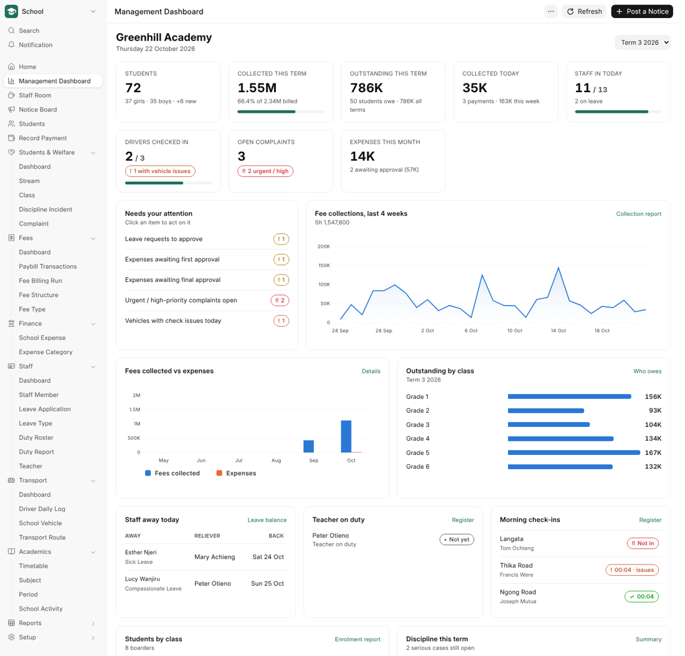
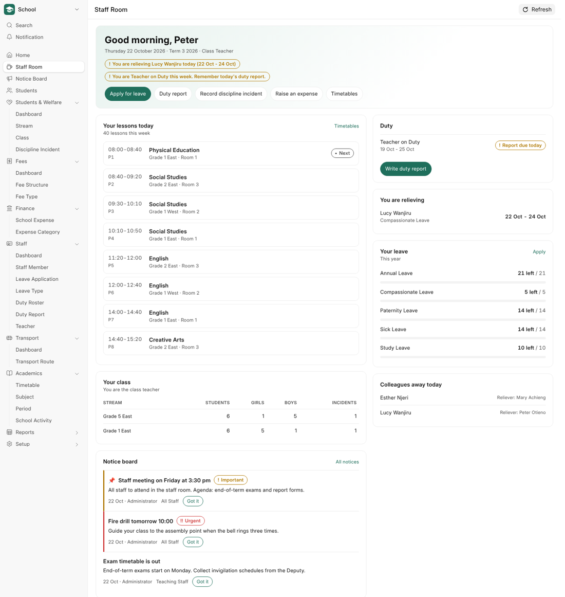
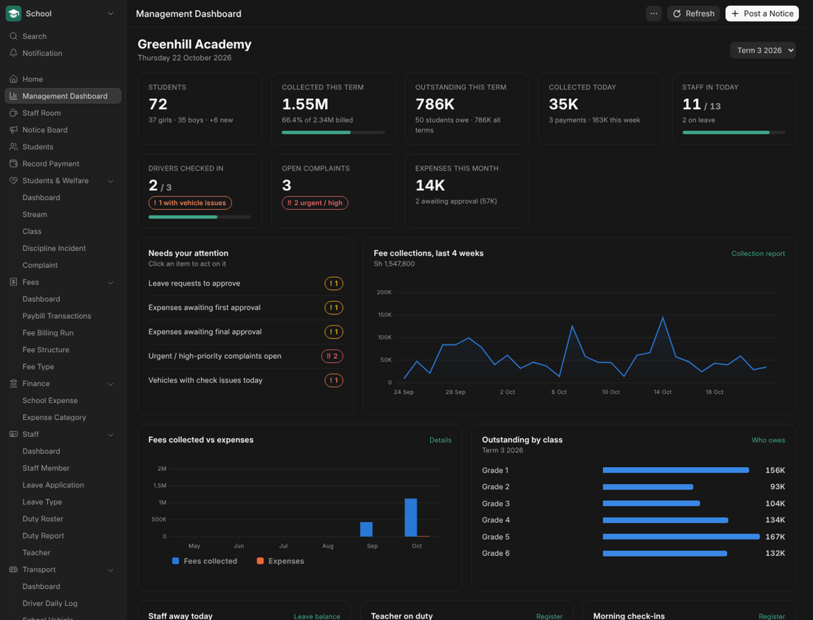
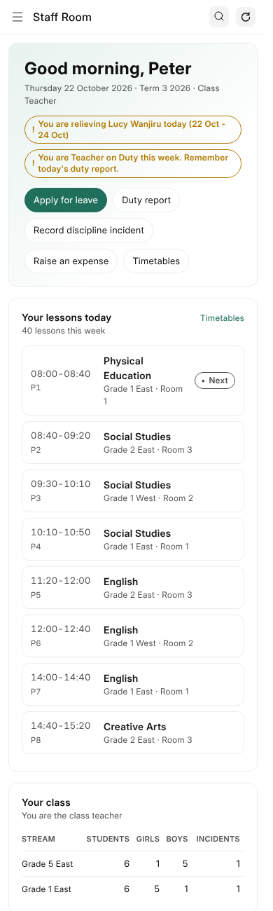

# Dashboards & notice board

## Management Dashboard
*Sidebar → Management Dashboard* (Head Teacher, Bursar, School Admin)

One screen for school leadership, refreshed each time it's opened:

* **Headline tiles:**
  * students (girls/boys, new this term);
  * fees collected this term with % of billed, outstanding and how many students owe;
  * collected today and this week;
  * staff in today;
  * drivers checked in;
  * open complaints;
  * expenses this month.

  Click any tile to open the detail behind it.
* **Needs your attention:** leave to approve, expenses at each approval level, Paybill payments not matched to a student, urgent complaints, complaints open more than 3 days, drivers not checked in, vehicles with failed checks, missing duty reports. Each item opens the list to act on. When nothing is waiting it says *All clear*.
* **Charts:** fee collections over the last 4 weeks; fees collected vs expenses per month; outstanding by class.
* **Today:** who is away and who is relieving them, the teacher on duty and whether the report is in, and each route's morning check-in (on time / issues / not in).
* **Students by class** and **discipline this term**.
* **Notice board:** what staff are seeing, with how many have acknowledged each notice.

Use the term selector (top right) to look at an earlier term. **Post a Notice** is the main button.



## Staff Room
*Sidebar → Staff Room*: every teacher's (and staff member's) home screen.

* A greeting with today's date and term, plus reminders: *you are relieving X today*, *you are Teacher on Duty, remember today's report*, and for drivers *morning check-in not done*.
* **Quick actions:** apply for leave, write the duty report, record a discipline incident, raise an expense, timetables (or morning check-in for drivers).
* **Your lessons today** from the timetable, with the current lesson highlighted and the next one marked.
* **Your class** (for class teachers): students, girls/boys, discipline incidents this term.
* **Notice board** with a **Got it** button, so management can see who has read each notice.
* **Duty**, **You are relieving**, **Your leave** (balance per type and upcoming leave), **Colleagues away today**.

It works on phones, so teachers can use it from the staff room or the corridor.



## Notice board
*Sidebar → Notice Board → New*

* **Who it's for:** All Staff, Teaching Staff, Non-Teaching Staff, Drivers or Management.
* **How it's marked:** priority (Normal / Important / Urgent), pin to top, show until (default 14 days).
* **SMS:** tick *Also send by SMS* to text it too.
* **When it's sent:** as soon as you save, everyone in the audience gets a notification. Notices dated in the future are sent on that day. The notice form shows *x of y acknowledged*.

## Dark mode and phones
Both dashboards follow the user's theme (*avatar → Toggle Theme*) and reflow for phones.

 

## Demo data (for presentations)
On an **empty** test site with developer mode on:

```bash
bench --site demo.localhost set-config developer_mode 1
bench --site demo.localhost execute school_erp.demo.make_demo
```

This creates about 70 students with fees and 4 weeks of payments, staff, a timetable, duty roster, leave, notices, complaints, discipline, expenses and today's driver check-ins.

Demo logins: `head@demo.school` (management) and `teacher@demo.school` (teacher), both with password `Demo@2026`. It refuses to run on a site that already has students.
