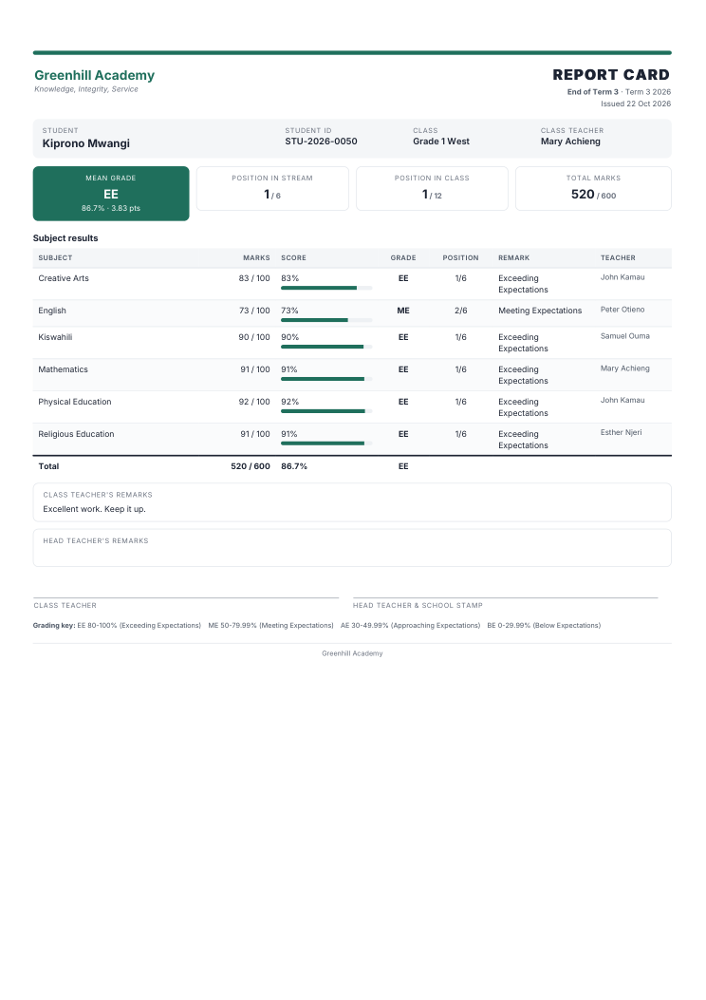
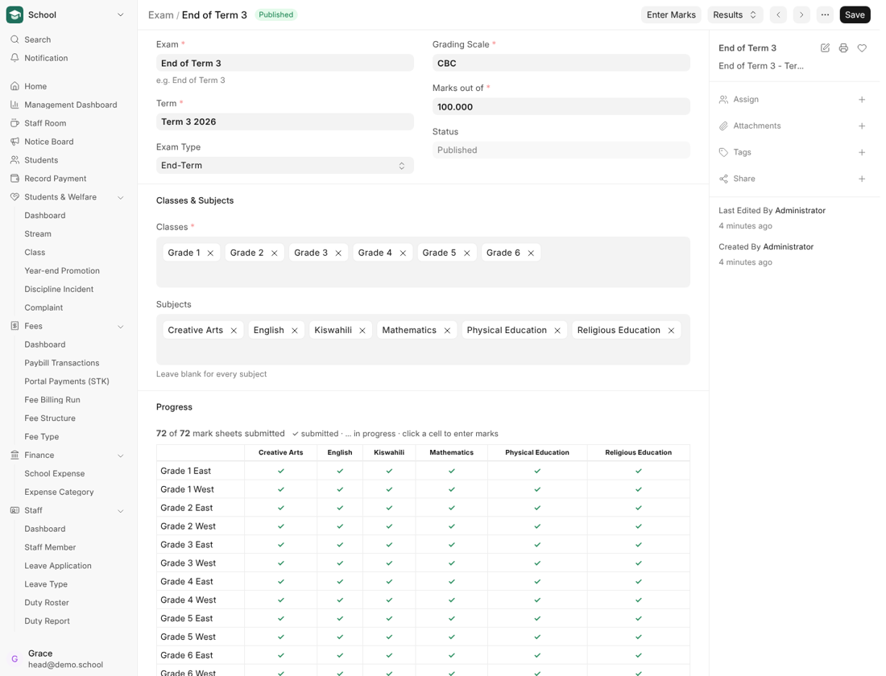
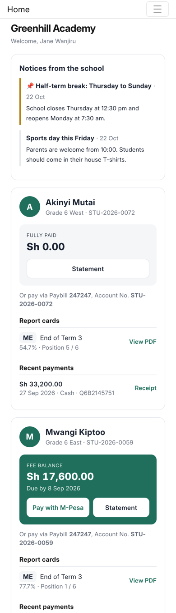
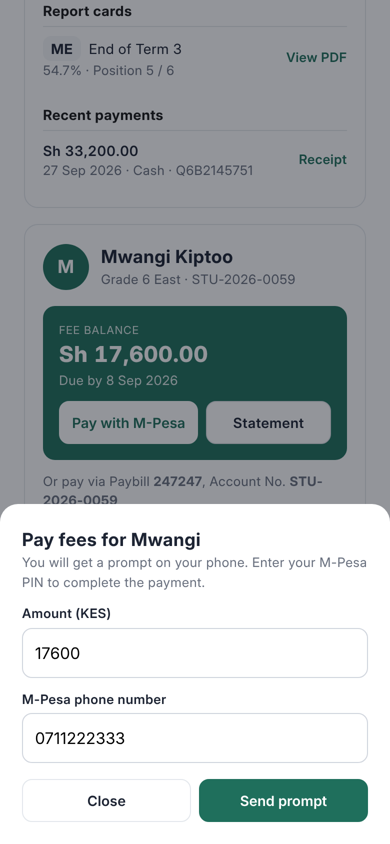

# Exams & report cards, parent portal, year-end promotion

New licence modules: `exams` and `portal`. Year-end promotion is part of the core.

---

## Exams & report cards

**Setup:** *Run School Setup* installs two grading scales:

| Scale | Bands |
|---|---|
| **CBC** | EE 80-100, ME 50-79, AE 30-49, BE 0-29 |
| **KCSE (8-4-4)** | A 80-100 down to E 0-29, points 12 to 1 |

The default follows *School Settings → Education system*. Edit the bands or add your own scale under **Grading Scale**. Gaps and overlaps are refused.

**1. Create the exam:** *Exam → New*. Give it a name (e.g. *End of Term 3*), a term, a type (Opener / CAT / Mid-Term / End-Term / Mock), the classes it covers, and optionally the subjects (blank = all). Set the grading scale and what marks are out of.

**2. Teachers enter marks:** on the Exam, the **Progress** grid shows every stream × subject: ✓ submitted, … in progress, blank not started.
* Clicking a cell opens the mark sheet. The stream's students are filled in automatically, and the subject teacher comes from the timetable.
* Type marks and press **Enter** to move down. Tick **Absent** for anyone who missed it.
* Marks are checked against the maximum, and grades appear as you save.
* **Submit** when the class is done. A sheet can't be submitted with blank marks, and each stream/subject has one sheet.

**3. Generate report cards:** *Exam → Results → Generate Report Cards*. For every student it calculates:
* total marks and mean %;
* mean grade, and mean points (8-4-4);
* position in stream and in class, with ties sharing a place (1, 2, 2, 4);
* position in each subject;
* change since the previous exam.

Absent subjects are shown but left out of the mean. A suggested class-teacher remark is filled in ("Very good performance… Improved by 6% since the last exam"). Teachers and the Head Teacher can edit remarks on each **Report Card**, and regenerating keeps their edits.

**4. Publish:** *Results → Publish to Parents* makes the cards visible on the parent portal. Each parent gets an SMS with the mean grade and position, and the PDF by email if an email is on file.

**Reports:** **Exam Merit List** (ranked by class or stream, with every subject and the change since last exam) and **Exam Subject Analysis** (mean %, highest and lowest, and grade spread per subject per stream, with a chart).

---

## Parent portal

Parents sign in at **`https://<school-site>/login`** with their **phone number** (`0712 345 678` or `254712345678`) or email. They land on **`/parent`**, which is built for phones and shows, for each of their children:
* the **fee balance** and due date, with a **Pay with M-Pesa** button and the Paybill/account number as a fallback;
* the **fee statement** (PDF);
* **report cards** that have been published (PDF);
* **recent payments**, each with a receipt PDF;
* **notices from the school** at the top.

Parents only ever see their own children. They have no access to the staff desk or to any other record; Frappe shows them "Not Permitted".

**Giving parents access**
* One family: Student → Fees → **Give Parents Portal Access**.
* Everyone: School Settings → Parent Portal → **Give All Parents Portal Access**.

Each guardian with a phone or email gets a login, and the message on screen lists any new passwords. With SMS on, they're texted their login and password (edit the text under *School Settings → Parent Portal & Exams*). A parent with several children at the school sees all of them on one login, because the same phone number is linked to each child.

**Notices to parents:** *Notice Board → New* with audience **Parents**, optionally limited to one class. It shows on the portal, and *Also send by SMS* texts every guardian who accepts SMS.

### Paying from the portal (M-Pesa Express / STK Push)

1. Safaricom must enable **M-Pesa Express** on the school's paybill and give you a **passkey**. For the sandbox, use short code 174379 and the passkey from the Daraja test credentials page.
2. Under School Settings → M-Pesa, tick **Allow parents to pay with an M-Pesa prompt** and enter the passkey. The callback uses the same public URL and secret token as Paybill auto-posting.
3. The parent taps **Pay with M-Pesa**, checks the amount (it defaults to the balance) and phone number, and taps **Send prompt**. Their phone asks for their M-Pesa PIN, and the portal shows *Payment received* within seconds.

Behind the scenes:
* Safaricom's result is recorded as a Paybill transaction, keyed by its M-Pesa receipt number, and posted to the child by the same code as Paybill payments. A payment can never be posted twice, even if the Paybill notification for it also arrives.
* Cancelled or timed-out prompts post nothing.
* If Safaricom's result doesn't arrive, the app asks Safaricom for it every 5 minutes, and gives up on a request after 30 minutes.
* Every attempt is listed under **Portal Payments (STK)**.

 

---

## Year-end promotion

**Before you start:** check each class's **Next Class** (set by Run School Setup: PP1→PP2→Grade 1…). The top class has none, so it graduates.

1. *Year-end Promotion → New*: from year, to year, and optionally which classes (blank = whole school).
2. **Get Students** lists everyone with their default action and destination:
   * **Promote:** Grade 4 East → Grade 5 East (same stream name). Missing streams can be created automatically.
   * **Graduate:** students in the top class.
3. Change the action to **Repeat** or **Left School** for anyone who shouldn't move up. The summary shows how many will be promoted, graduated and repeating, and how many have a fee balance and how much.
4. **Promote N students** applies it. Each row shows Done or the error. The new year can be made current automatically.

**Fee balances carry forward automatically:** they stay on the student's account and appear as *Balance from earlier terms* on the next statement and in the next term's balance. Then bill the new term as usual (or let automatic term billing do it).
